# What's coming — development update, October 2026

> **Coming soon.** Everything on this page is built and running on the developer's own farm. It ships in the next update of GPU Farm Monitor — no exact date yet, but it is close. The current release is [0.1.0 beta](https://github.com/Crazykkid2000/GPU-Farm-Monitor/releases/tag/v0.1.0-beta).

It's been a week since 0.1.0 beta went up, and a lot has landed. Here's what we've been building.

## Rigsby grew up

Rigsby (GFM's mascot and assistant) got his biggest update yet:

- **He talks.** Rigsby has a real voice now. He reads his replies out loud, his mouth moves with it, and his bubble,
  mouth and sound all start together. Hundreds of hand-written lines, every one of them voiced.
- **He keeps you company.** Open the Rigsby Assistant window and he flies up and sits on its edge while you chat, riding
  along when you move it. One Rigsby, everywhere - no more pop-ins fighting each other.
- **Seasons, holidays and a wardrobe.** He dresses for the season and the holidays (and your birthday), decorates his
  house for Christmas, Halloween, Easter and more, and takes it all down again when it's over. You can set what he
  celebrates, pick a favourite outfit, or turn the wardrobe off.
- **Play with him.** Fetch with a ball that bounces off your windows (he'll ride his GPU rocket after a long throw, and
  steal it if you hold it near him), a proper **hide and seek** game with levels, a trampoline, a paper plane, a
  skateboard, a motorcycle, a guitar, a telescope at night, camping out under the stars when you're away...
- **Tickle him, high-five him, spin him dizzy.** He reacts to how you move the mouse.
- **Companion mode (opt-in, off by default).** Unlock it and he gets eyes (a vision model on your own farm looks at the
  screen), a director that keeps him fresh so he never repeats himself, and a memory of what you told him and what you
  did together. Everything stays on your farm. One switch puts him back to plain Assistant mode.
- **He's part of the app.** Rigsby announces when a file lands, flags hot GPUs, and gives "I'll show ya" tours of GFM.

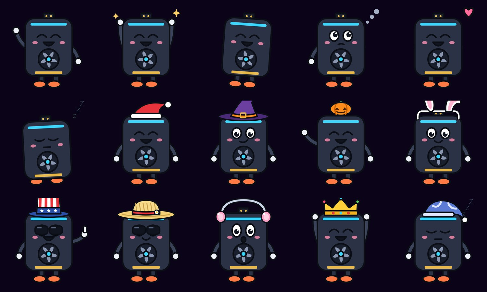
*Rigsby: a few of his moods, and what he wears through the year.*

## Workers: one rig, many LLMs

A single button now splits a multi-GPU rig into **workers** - groups of its GPUs, each running its own llama.cpp with
its own model, each showing up in GFM as a rig of its own. Chat, Team Mode, App Builder seats, the scheduler and the
phone app all just see more rigs.

Why it matters: on a 9-GPU box, one whole-rig LLM answered 6 chats at once at about 12 tok/s total. Split into three
3-GPU workers, the same box delivered about 128 tok/s. No VMs, no reinstalls - change the layout and GFM restarts only
what it has to (and asks first if someone is using it).

Alongside that: **generation groups**. Lock a GPU to image / music / 3D generation (ONLY) or share it with an LLM
(SHARED), deploy services per worker or per group so you always know exactly which GPU is doing what, and the chat's
tool list stays tidy - tools whose GPU has no group simply wait out of the way.

## The engine rework

The foundation under GFM was rebuilt so one busy thing can never stall the window:

- **Rig readers run in their own process.** The window just gets snapshots. At 200 rigs, worst-case frame stutter
  dropped from ~250 ms to ~40 ms and the window's thread count went from 239 to 9.
- **App Builder engines run in their own process.** Three running teams now cost the window nothing.
- **The desktop client draws Neon Fusion itself.** From 7 fps streamed off the server to 60 fps on the client's own GPU,
  at a fifth of the CPU.
- **Projects moved to SQLite.** App Builder project data (tasks, logs, ledger) now lives in a proper database - faster
  reads, safe with several processes writing.
- **A new web home.** GFM's main window is now a web page served by GFM itself, with the same look on the desktop, in a
  browser and on the phone. 50 rigs on screen, every frame on time.
- Big-farm fixes along the way (a garbage-collection stall that grew with your rig history: gone).

## The UI rework

GFM's main screens were rebuilt as web pages that GFM serves itself - the same screens, same look, in the desktop app,
in a browser on another PC, and on the phone, in all eight themes.

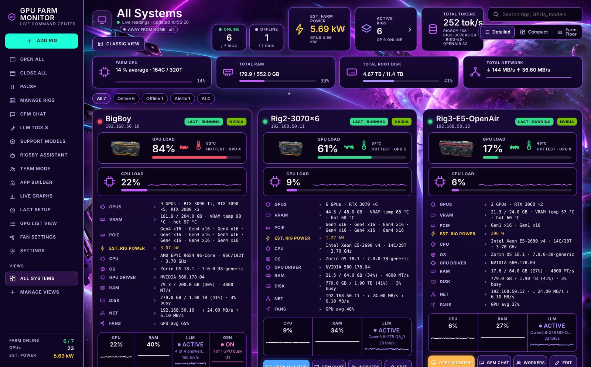
*ALL SYSTEMS, Detailed view, Neon Fusion Overdrive.*

- **A new home (ALL SYSTEMS)** with three views: **Detailed** (KPI tiles, farm CPU / RAM / disk / network sparklines,
  a GPU lane per rig with one bar per card coloured by temperature, the full spec list), **Compact** (five cards a row,
  each rig's hottest card drawn with its fans turning at the real fan speed), and **Farm Floor** - every GPU on the
  farm at once, standing in its rig's frame in its worker group, glowing in its temperature colour, fans at their real
  speed; click a card and its monitor opens. Plus a **FARM POWER** panel: a live kWh meter, your price per kWh, and
  what the farm is costing right now.

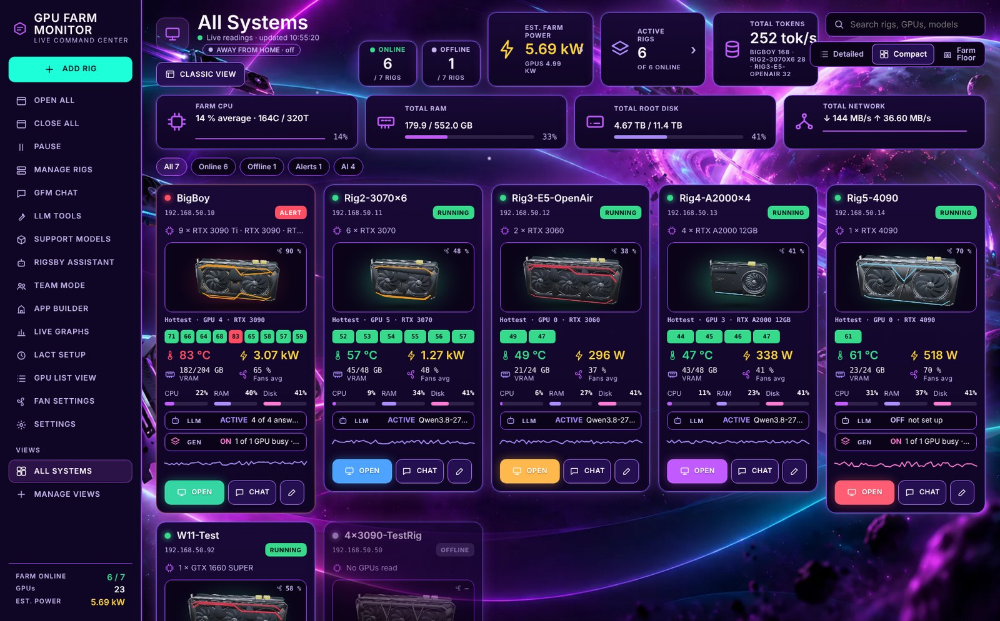
*Compact view: every rig's hottest card, fans turning at their real speed.*

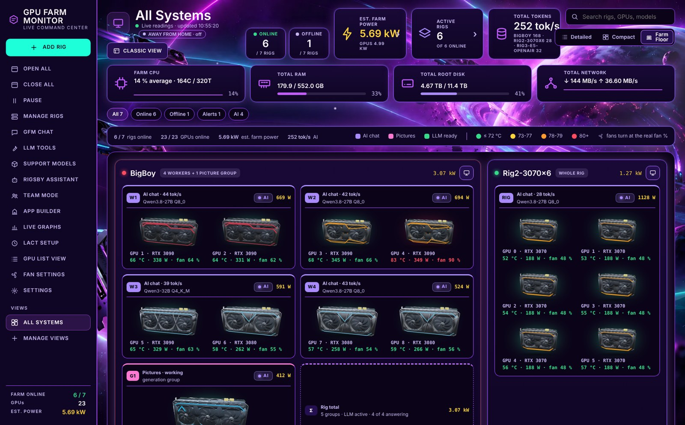
*Farm Floor: every GPU on the farm in its worker group.*

- **OPEN MONITOR redesigned around a 3D card.** Every GPU is drawn as a real 3D graphics card (GFM's own original
  designs, styled per maker and class) that shows its readings where they live: the heatsink glows with the GPU
  temperature, memory pads with the memory temperature, the fans spin at their real speed, the power plugs light with
  the draw, the top strip fills with the load. Tiles for power, hottest GPU, CPU, memory, disk busy, plus an **All
  sensors** view with every sensor the rig reports.

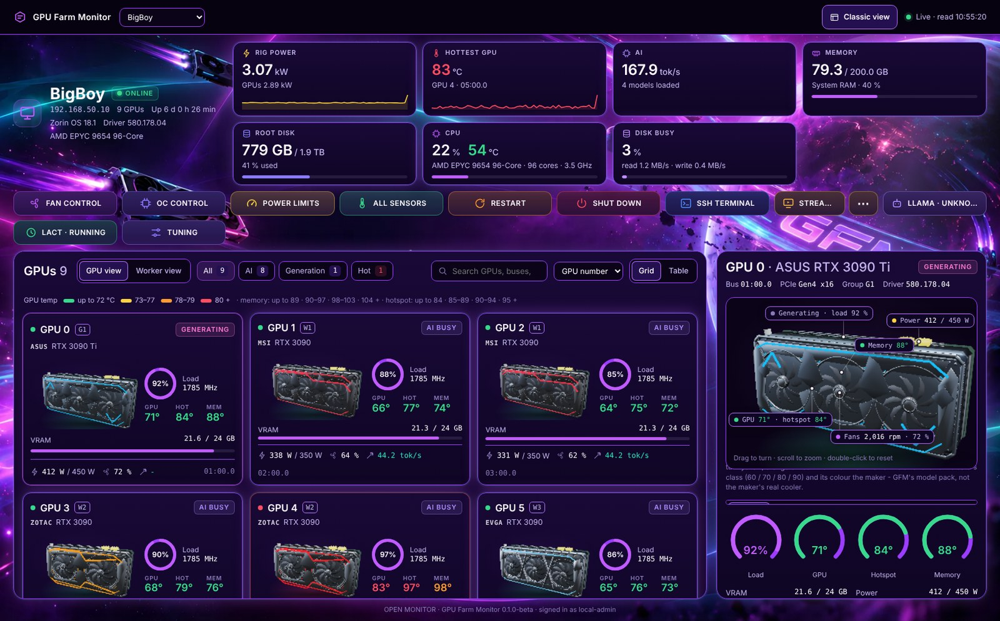
*OPEN MONITOR: the 3D card shows its readings where they live.*

- **MODELS page**: browse Hugging Face right inside GFM (filters for GGUF, vision, size, quant), see which quants fit
  your rig's disk, deploy with a live % / speed / ETA, load and unload per worker - and a jobs strip that follows your
  downloads wherever you are in the app, so you never lose one again.
- **RIG MANAGEMENT** in its own window; **MANAGE RIGS**, **SEND FILE** and **FILES** right on every rig card.

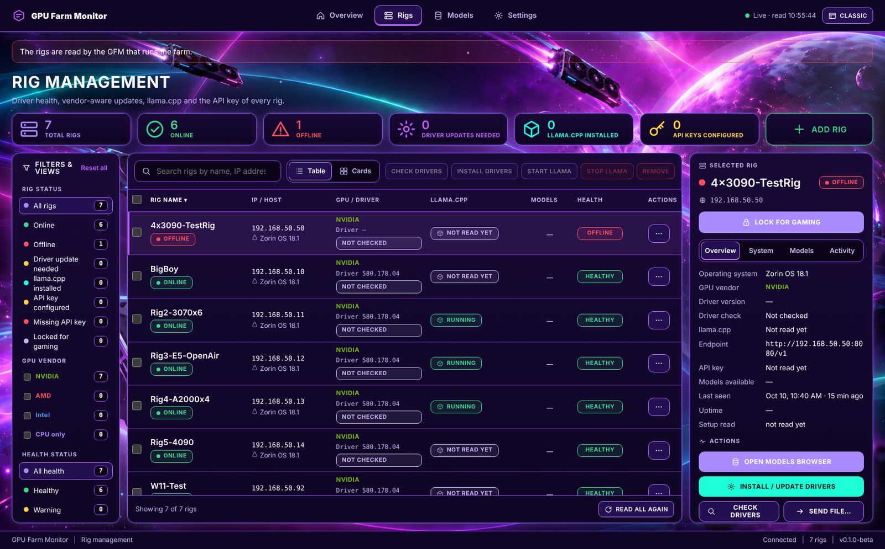
*RIG MANAGEMENT.*

- **LLAMA.CPP SETTINGS** got a live **VRAM gauge** (watch a model load into memory, with the MB/s it's going in at), a
  **LAUNCH SCRIPT** button right beside VALVES in every chat, and **per-model settings**: GFM now sizes context, slots
  and cache per model automatically - the biggest context that fits, more parallel chats when the VRAM holds them -
  and keeps your hand edits.
- **Lock a whole rig to generation** if you want (with a clear warning that no LLM can chat there).
- **UI size on the web pages too** (75-300 %, TVs included), a phone menu for the sidebar, and solid panels on the
  Neon Fusion themes - the space backdrop shows around your windows, never through them.
- **Rigsby's bug hunt**: tell him to go look and he walks every window, has a vision model on your farm check each one
  for cut-off text, overlaps and empty panels, and files what he saw. He found real ones.

## File transfer and away from home

- **Send a file to any rig** from its card, browse a rig's folders, download, upload, and send **rig to rig** - the file
  goes straight between the two machines, never through your PC. Everything lands in a Received folder. Big files
  resume by themselves if the link drops (tested: a 29 GB model at line rate, paused and resumed, checksums matching).
- **A transfers window** with a live farm map - every running transfer is a glowing wire between two machines, with
  speed, progress and a drop zone.

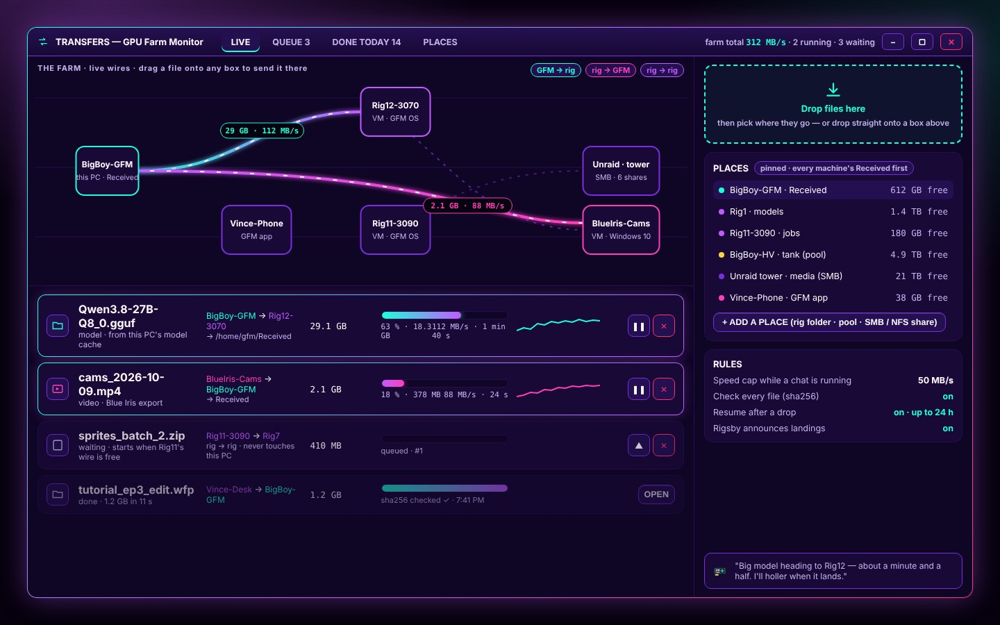
*The TRANSFERS window (approved concept - the built one looks like this with your own rigs).*

- **Away from home.** Sign in once and your GFM server becomes the hub for your own private network (Tailscale,
  bundled, no driver, no port forwarding). Your phone and clients see the farm like you're on the LAN.

## GFM OS and the Hypervisor (coming after that)

This is the big one. GFM OS is a hypervisor and a desktop OS on **one USB key**, built on Ubuntu LTS. Boot a machine
from the key and it shows up in GFM's new **Hypervisor** tab by itself. Then you choose:

- **Bare metal** - installs GFM OS to the machine's drive, it becomes a rig like any other, you take the key back.
- **VM server** - runs from the key, headless, managed entirely from GFM: pools and RAIDs in plain words (Single /
  Mirror / Stripe / RAIDZ), VMs with CPU/RAM/disk sliders, **pick a GPU to pass through** from a list that tells you
  READY / IN USE / NEEDS BIOS with the exact BIOS menu to change, hot-plug USB to a VM, a real USB mode that hands a
  whole USB port to a VM, a Proxmox-style console as a backup, and GFM Stream paired automatically so a VM with a GPU
  streams to your phone right away.

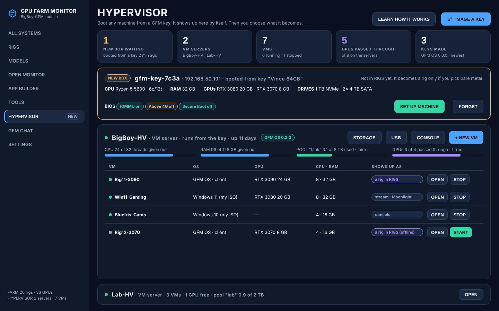
*The HYPERVISOR tab (concept).*

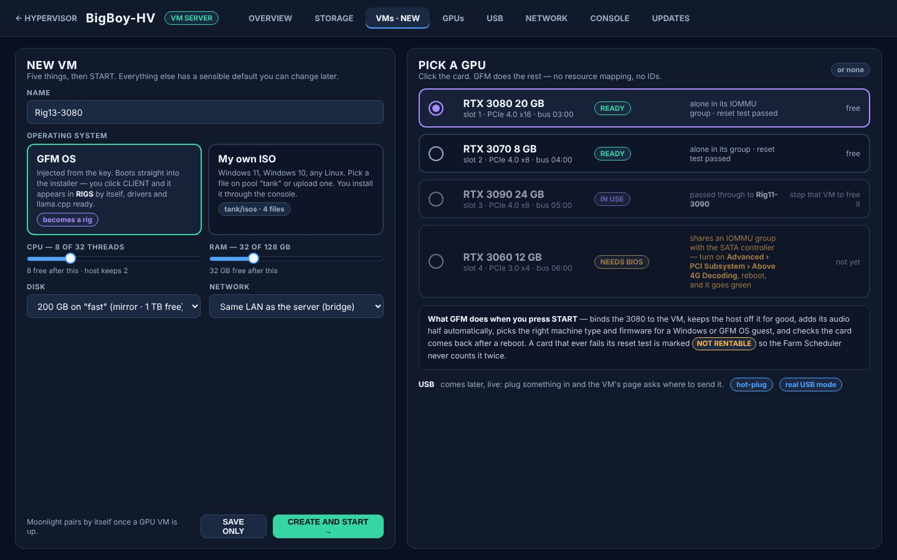
*New VM: pick a GPU to pass through - READY / IN USE / NEEDS BIOS (concept).*

The desktop side: XP's ease, a modern Windows 7 feel, all eight GFM themes as full OS themes (Neon Fusion is the
default - think glass), a Start orb, a tray with your farm's numbers, network shares that just work, and a copy window
that beats the one in Windows. The point of it: **double-click an EXE and it runs.** GFM picks the recipe, builds the
program its own C: drive, adds what it needs and puts it in Start - no Wine windows, no prefixes, no hunting for the
exe. If it doesn't launch, a strip of four settings lets you cycle through until it does, and anything that can't run
under Wine says so on the first try instead of looping.

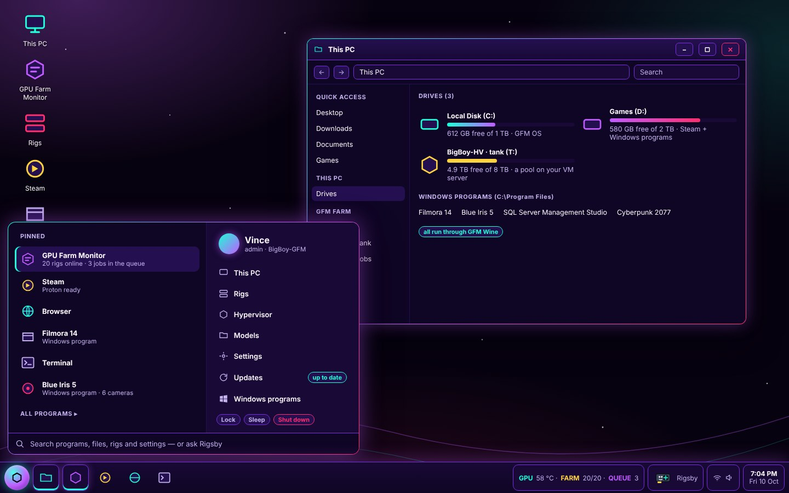
*GFM OS desktop in Neon Fusion, Start menu open (concept).*

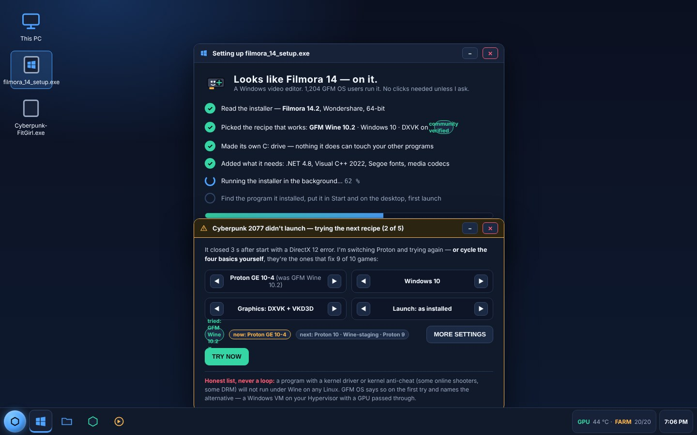
*Double-click an EXE: Rigsby sets it up; the didn't-launch strip when a game needs a different recipe (concept).*

And yes - Rigsby is built into the OS, and (opt-in, with a hard always-ask list) he can drive it: "move everything in
Received to the media share and open my last project."

Where it stands today: the first GFM OS image boots in testing, bare-metal install and VM server have both passed
their automated runs, the first real key has been written, and the first test box is being set up. This one lands
after the update above — more soon.

## When

Soon. The update above is being rolled into the next public build now; the OS field tests follow. As always: every
feature in GFM runs on your own hardware, nothing leaves your network. Watch the
[releases page](https://github.com/Crazykkid2000/GPU-Farm-Monitor/releases) — and the
[video tutorials](https://www.youtube.com/playlist?list=PLL9X1y4YCd4M), where Rigsby shows the new screens as they land.

---

*GPU Farm Monitor by crazykkid2000productions. Development started 18 Sep 2026.*
